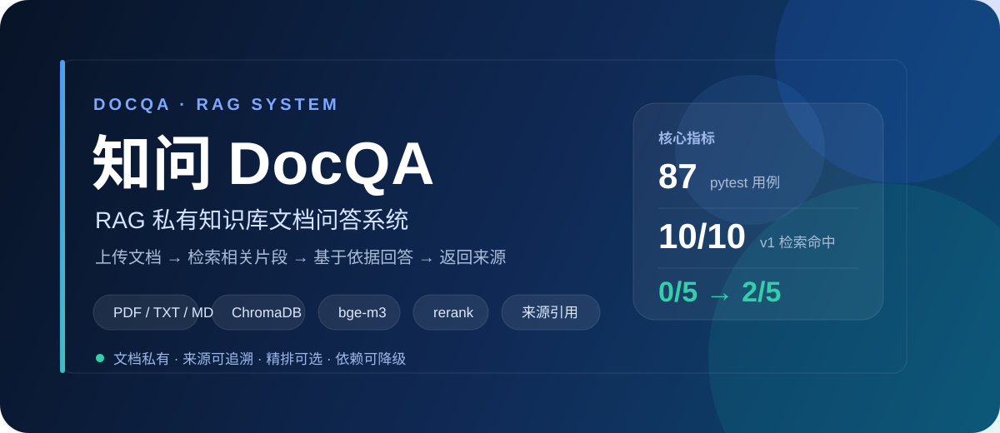
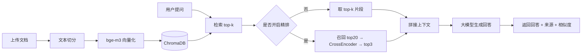
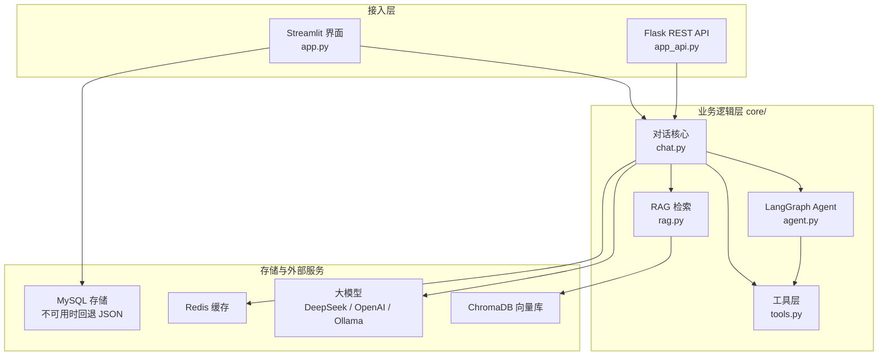

<div align="center">
  
  <br />
  <br />
  <h1>知问 DocQA</h1>
  <p><b>RAG 私有知识库文档问答系统</b></p>
  <p>上传 PDF / TXT / Markdown，系统完成切分、向量化与入库；提问时先检索相关片段，再由大模型生成带来源依据的回答。</p>
</div>

<div align="center">
  <a href="https://github.com/MWQ111/ma-ai-chat5201314/actions/workflows/ci.yml"></a>
  
  
  
  
  
  
  
</div>

---

> [!IMPORTANT]
> 当前版本定位为 **单团队、单知识库** 的私有文档问答系统。文档与向量库保存在本地；检索出的必要片段会发送给所选大模型。使用 Ollama 时可实现模型与嵌入均本地运行。多用户租户隔离、请求限流、Token 配额与生产级审计尚未完成，暂不作为公开 SaaS 直接运营。

## 🚀 30 秒了解

| 输入 | 检索 | 输出 |
|---|---|---|
| PDF / TXT / Markdown 上传后自动切分 | ChromaDB 向量检索 + bge-m3；可选 rerank 精排 | 基于文档片段的回答 + 来源文件 + 相似度 |

<div align="center">
  <table>
    <tr>
      <td align="center"><b>87</b><br/>pytest 用例</td>
      <td align="center"><b>10/10</b><br/>v1 Top-3 命中</td>
      <td align="center"><b>0/5 → 2/5</b><br/>v2-hard 近义干扰</td>
      <td align="center"><b>44%</b><br/>缓存命中率</td>
      <td align="center"><b>1.19s</b><br/>精排 P50 代价</td>
    </tr>
  </table>
</div>

---

## 📖 项目简介

通用大模型不知道你的私有文档，直接回答容易缺少依据。知问 DocQA 把文档问答拆成一条可验证的 RAG 链路：

```text
上传文档 → 切分 → 向量化 → 检索 → 可选 rerank → 生成回答 → 返回来源
```

它解决的不是“再做一个聊天框”，而是三个具体问题：

- **文档多、查找慢**：课程资料、项目文档、制度手册散落在群文件和网盘里；
- **通用模型不懂私有上下文**：直接问模型只能得到通用答案；
- **回答没有出处**：需要知道结论来自哪份文档、哪一段。

推荐使用场景：

- 课程资料 / 项目文档 / 组会纪要问答；
- 企业内部制度、SOP、入职手册；
- 客服 FAQ、售后手册、产品说明；
- 研发接口文档、部署手册、故障复盘。

---

## ✨ 核心能力

- **RAG 文档问答**：支持 PDF / TXT / Markdown 上传、切分、向量化入 ChromaDB；提问时先检索 top-k 片段，再交给大模型生成回答。
- **来源可追溯**：回答附带来源文件与相似度，便于核对依据。
- **检索质量优化**：默认优先 bge-m3 多语言嵌入；支持 OpenAI 与本地内置模型回退；可选 rerank 精排，默认关闭、按需开启。
- **文档管理**：上传、同名去重、文档列表、按文档删除、清空知识库。
- **多模型切换**：DeepSeek / OpenAI / Ollama 统一适配，各模型独立 temperature / max_tokens 参数。
- **双入口**：Streamlit 交互界面 + Flask REST API（含可取消的 SSE 流式接口）。
- **缓存与持久化**：Redis 回答缓存；MySQL（SQLAlchemy ORM）会话持久化，MySQL 不可用时回退本地 JSON。
- **Agent 与工具调用**：LangGraph 状态图实现“规划 → 执行工具 → 反思 → 自主结束”；内置时间、安全数学计算、网络搜索。
- **优雅降级**：RAG、缓存、存储、Agent 或精排模型任一异常时，主流程不中断。
- **Docker 部署**：docker-compose 编排应用、Redis 与 ChromaDB。

---

## 🧭 项目状态

| 模块 | 状态 |
|---|---|
| RAG 文档问答主链路 | ✅ 已完成 |
| 来源引用与相似度 | ✅ 已完成 |
| bge-m3 / OpenAI / 本地嵌入回退 | ✅ 已完成 |
| rerank 精排 | ✅ 已完成，默认关闭 |
| v1 基础检索评测 | ✅ 10/10 |
| v2-hard 近义干扰专项 | ✅ 0/5 → 2/5 |
| 87 个 pytest 用例 + GitHub Actions CI | ✅ 已完成 |
| Docker Compose 编排 | ✅ 已完成 |
| Cloudflare Tunnel 临时公网演示 | ✅ 已打通 |
| 正式服务器与域名部署 | 🚧 待完成 |
| 用户登录与多租户隔离 | 🚧 待完成 |
| 请求限流与 Token 配额 | 🚧 待完成 |

---

## 🖼 项目总览

### RAG 主链路



### 分层架构



---

## 🧱 技术栈

| 层级 | 技术 |
|---|---|
| 界面 | Streamlit |
| API | Flask、SSE 流式输出 |
| RAG | ChromaDB、bge-m3、RecursiveCharacterTextSplitter、PyPDF |
| 精排 | BAAI/bge-reranker-v2-m3、sentence-transformers |
| Agent | LangGraph、Function Calling |
| 模型 | DeepSeek、OpenAI、Ollama |
| 存储 | MySQL + SQLAlchemy ORM、本地 JSON 降级 |
| 缓存 | Redis |
| 测试 | pytest、ruff、GitHub Actions |
| 部署 | Docker、docker-compose |

---

## 🚀 快速启动

### 环境要求

- Python 3.10+
- MySQL 8.0（可选，未启动时使用本地 JSON）
- Redis 7.x（可选，未启动时缓存自动降级）
- Ollama（可选，推荐用于 bge-m3 本地嵌入）

### 本地运行

```bash
git clone https://github.com/MWQ111/ma-ai-chat5201314.git
cd ma-ai-chat5201314

python -m venv .venv

# Windows
.venv\Scripts\activate
# macOS / Linux
source .venv/bin/activate

pip install -r requirements.txt
cp .env.example .env
# 编辑 .env，至少填入 DEEPSEEK_API_KEY
# 使用 Ollama 本地模型时可跳过

# 可选：启动 Ollama 并拉取嵌入模型
ollama pull bge-m3

# 启动界面
streamlit run app.py
# 浏览器打开 http://localhost:8501
```

启动 REST API：

```bash
python app_api.py
# API 监听 http://localhost:5000
```

### Docker Compose

```bash
cp .env.example .env
docker compose up -d --build
# 访问 http://localhost:8501
```

### 本地完整模式 / 公网演示模式

```powershell
# 本地完整模式：显示 API 配置
$env:DOCQA_PUBLIC_DEMO="0"

# 公网演示模式：隐藏 API 配置，密钥只从服务端环境变量读取
$env:DOCQA_PUBLIC_DEMO="1"
```

---

## 📊 性能与检索评测

### 1. 缓存基准

100 次请求，其中 40% 为重复提问：

| 指标 | 开缓存 | 关缓存 | 提升 |
|---|---:|---:|---:|
| P50 延迟 | 0.90s | 1.66s | 0.76s |
| P95 延迟 | 2.42s | 2.43s | 0.01s |
| 缓存命中率 | 44.0% | 0.0% | — |

复现：

```bash
python scripts/bench.py
```

### 2. 语义缓存阈值实验

使用 13 组同义改写与 7 组难负例：

| 阈值 | 同义命中 | 误判 | 结论 |
|---|---:|---:|---|
| 0.95 | 6/13 | 0/7 | ✅ 零误判，安全阈值 |
| 0.90 | 10/13 | 1/7 | ⚠️ 多命中 4 个，但出现误判 |

最终选择 **0.95**：宁可少命中，也不能返回错误答案。

```bash
python scripts/eval_semantic_cache.py
```

### 3. rerank 消融实验

#### v1 基础评测集

| 指标 | 精排 OFF | 精排 ON |
|---|---:|---:|
| Top-3 命中 | 10/10 | 10/10 |
| 诱饵题通过 | 3/3 | 3/3 |
| 正确块排第 1 | 8/10 | 9/10 |
| 正确块平均排名 | 1.20 | 1.10 |

结论：**基础事实题上，纯向量已经足够；精排主要改善首位排序，不是通用提分器。**

#### v2-hard 近义干扰专项压力集

语料：原始评测文档 + 4 份近义干扰文档（旧版本、FAQ、语义检索说明、缓存概览）。

| 指标 | 精排 OFF | 精排 ON |
|---|---:|---:|
| Top-3 命中 | 0/5 | 2/5 |
| 正确块排第 1 | 0/5 | 2/5 |
| MRR | 0.00 | 0.40 |

结论：**在 FAQ、旧版本和近义章节共存的知识库中，精排具有明确作用；但当前模型仍无法解决全部近义干扰。**

复现：

```bash
python scripts/eval_rerank_original.py
python scripts/eval_rerank_v2_hard.py
python scripts/show_rerank_v2_hard.py
```

### 4. 精排延迟代价

| 指标 | 纯向量 | 精排 | 净增 |
|---|---:|---:|---:|
| P50 | 38.1ms | 1232.1ms | +1194ms |
| P95 | 50.8ms | 1478.2ms | +1427ms |

由于 v1 基础集没有命中提升，精排默认关闭；仅在近义干扰较多的知识库中按需开启。

---

## 🧪 测试

项目包含 **87 个自动化测试**，分布在 8 个 `test_*.py` 文件中：

| 测试文件 | 用例数 | 覆盖内容 |
|---|---:|---|
| `test_tools.py` | 14 | AST 计算、时间工具、工具定义 |
| `test_api.py` | 35 | REST 接口正常/异常返回、鉴权 |
| `test_app.py` | 7 | Streamlit 渲染、搜索过滤、回归 |
| `test_cache.py` | 8 | 缓存键、语义相似度、降级 |
| `test_agent.py` | 5 | Agent 规划/执行/反思 |
| `test_models.py` | 11 | 多模型配置解析 |
| `test_text_utils.py` | 6 | Token 估算 |
| `test_e2e_mysql.py` | 1 | MySQL 端到端读写 |
| **合计** | **87** | |

```bash
pytest -v
```

> API 测试用 mock 隔离外部依赖；MySQL E2E 用例检测不到数据库时自动 skip。

---

## 🔐 数据与隐私边界

- 文档与 ChromaDB 向量库保存在本地或你的服务器；
- 检索出的必要片段会发送给所选大模型服务；
- 使用 Ollama 时，模型与嵌入都可本地运行；
- 当前版本是单团队、单知识库模式；
- 公开长期运行前需要补齐：登录认证、租户隔离、文档权限、限流配额、审计与备份。

---

<details>
<summary><b>🌐 REST API 接口文档</b>（点击展开）</summary>

## 🌐 REST API

启动：`python app_api.py`，默认地址 `http://localhost:5000`。

除 `GET /ping` 外，请求需携带：

```http
X-API-Key: <MAAI_CHAT_API_KEY>
```

### 问答接口

| 方法 | 路径 | 说明 |
|---|---|---|
| GET | `/ask?q=...` | 纯文本问答 |
| POST | `/chat` | 一次性返回完整回答 |
| POST | `/chat/stream` | SSE 流式输出，可取消 |
| POST | `/cancel/<request_id>` | 取消流式生成 |
| GET | `/ask_rag?q=...` | 基于当前知识库的 RAG 问答 |

### 对话管理接口

| 方法 | 路径 | 说明 |
|---|---|---|
| GET | `/conversations` | 查询对话列表 |
| POST | `/conversations` | 新建对话 |
| PUT | `/conversations/{conv_id}` | 修改对话标题 |
| DELETE | `/conversations/{conv_id}` | 删除对话及消息 |
| GET | `/conversations/{conv_id}/messages` | 查询消息 |
| POST | `/messages/{conv_id}` | 新增消息 |

</details>

<details>
<summary><b>📁 项目结构</b>（点击展开）</summary>

## 📁 项目结构

```text
ma-ai-chat5201314/
├── app.py                       # Streamlit 应用入口
├── app_api.py                   # Flask REST API
├── core/                        # 业务逻辑层
│   ├── __init__.py
│   ├── config.py
│   ├── db.py
│   ├── session.py
│   ├── chat.py
│   ├── agent.py
│   ├── tools.py
│   ├── rag.py
│   ├── cache.py
│   ├── models.py
│   └── text_utils.py
├── ui/                          # Streamlit UI
│   ├── sidebar.py
│   ├── chat.py
│   └── components.py
├── tests/                       # 87 个 pytest 用例
│   ├── conftest.py
│   ├── test_models.py
│   ├── test_tools.py
│   ├── test_text_utils.py
│   ├── test_cache.py
│   ├── test_agent.py
│   ├── test_app.py
│   ├── test_api.py
│   └── test_e2e_mysql.py
├── scripts/                     # 评测与基准脚本
│   ├── bench.py
│   ├── eval_rag.py
│   ├── eval_semantic_cache.py
│   ├── eval_rerank_original.py
│   ├── eval_rerank_v2_hard.py
│   └── show_rerank_v2_hard.py
├── evaluation/
│   └── v2_hard/                 # 近义干扰专项语料
├── demo/                        # 临时演示启动脚本
├── docs/screenshots/            # 界面截图
├── resources/
├── session_data/
├── chroma_db/
├── .env.example
├── requirements.txt
├── requirements-dev.txt
├── Dockerfile
├── docker-compose.yml
├── entrypoint.sh
├── LICENSE
└── README.md
```

</details>

## 🧭 后续计划

- [x] RAG 文档问答主链路
- [x] 来源引用与相似度
- [x] bge-m3 / OpenAI / 本地嵌入回退
- [x] rerank 精排与 A/B 评测
- [x] 87 个 pytest 用例与 GitHub Actions CI
- [x] Cloudflare Tunnel 临时公网演示
- [ ] 正式服务器与域名部署
- [ ] 用户登录与多租户数据隔离
- [ ] 请求限流、Token 配额与成本熔断
- [ ] 审计、监控、备份与可观测性看板

---

## 📄 许可证

本项目采用 **MIT** 开源许可证，可自由使用、修改与分发。

---

<div align="center">
  <b>如果这个项目对你有帮助，欢迎 Star ⭐</b>
</div>
